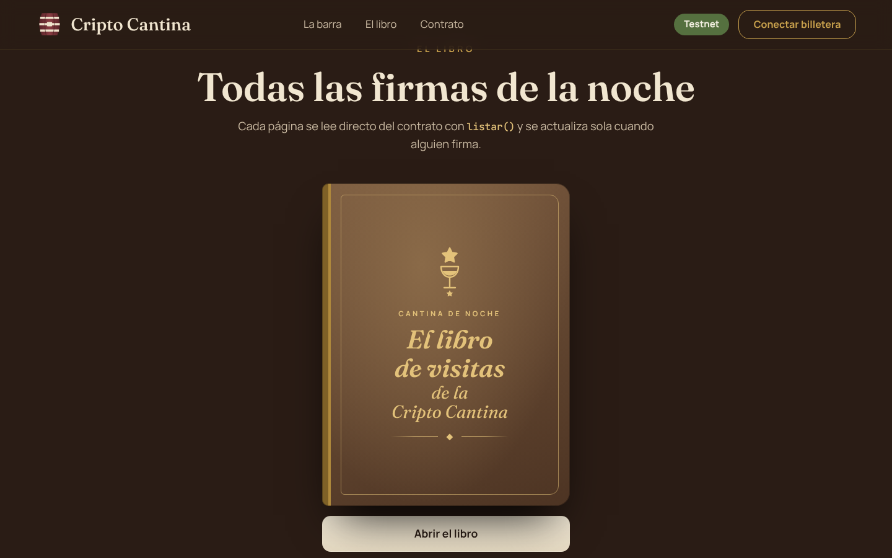
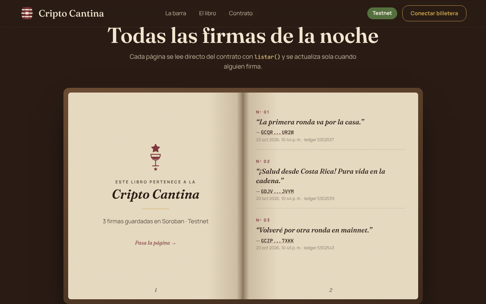
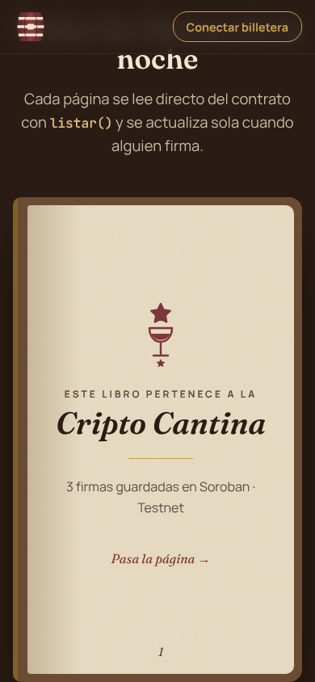

# 🍷 El libro de visitas de la Cripto Cantina

dApp para el **Reto #1 de Stellar Sessions**. Conectas tu billetera, escribes un
mensaje corto y lo firmas en la **testnet de Stellar**. Un contrato Soroban
guarda la firma y la página muestra todas las firmas en un libro que se hojea
página por página.


| Libro cerrado                                    | Libro abierto                                    |
| ------------------------------------------------ | ------------------------------------------------ |
|  |  |

<p align="center"></p>

## Contrato en testnet

|                     |                                                                                                                                    |
| ------------------- | ---------------------------------------------------------------------------------------------------------------------------------- |
| **ID del contrato** | `CAHUFFLIBRI2LJGVSVAAHPLSKYP2P64WFCOYMEY66RFGXHEIHHCA4GFB`                                                                         |
| **Red**             | Stellar Testnet (`Test SDF Network ; September 2015`)                                                                              |
| **Explorador**      | [Ver en Stellar Expert](https://stellar.expert/explorer/testnet/contract/CAHUFFLIBRI2LJGVSVAAHPLSKYP2P64WFCOYMEY66RFGXHEIHHCA4GFB) |

## Qué hace

**Requisitos del reto**

- ✅ Proyecto creado con [Scaffold Stellar](https://scaffoldstellar.org)
  (plantilla React).
- ✅ Contrato propio `libro-visitas` con `firmar(autor, mensaje)` y `listar()`.
- ✅ `firmar` llama a `autor.require_auth()`: el autor tiene que aprobar la
  firma en su billetera.
- ✅ El frontend usa el cliente TypeScript que genera Scaffold Stellar
  (`@stellar-scaffold/app-lib/clients`) y conecta billeteras con Stellar Wallets
  Kit (Freighter, xBull, Albedo, Lobstr, Hana…).
- ✅ Contrato desplegado en testnet.

**Puntos extra**

- ✅ **Una sola firma por dirección.** Si la misma dirección intenta firmar otra
  vez, el contrato responde con `Error::YaFirmo`.
- ✅ **Eventos.** Cada firma emite el evento `firma` con el autor como topic y
  el mensaje como dato. El frontend escucha ese evento y refresca el libro sin
  recargar la página.
- ✅ **Tests.** Seis tests en Rust: firmar y listar, autorización exigida, firma
  sin autorización, una firma por dirección, mensaje vacío o largo y emisión del
  evento.
- ✅ **Algo creativo.**
  - Un libro con tapa que se abre, hojas de pergamino que se pasan con animación
    3D, numeración `Nº 01`, fecha y ledger de cada firma.
  - Tu propia firma aparece marcada, con un botón "Ir a mi firma".
  - El fondo de la cantina está hecho solo con CSS y SVG: estantes con botellas,
    vigas y velas que titilan.
  - El sello rojo se estampa cuando firmas.
  - Si la cuenta no tiene fondos, aparece un botón para fondearla con Friendbot.
  - El diseño se adapta a móvil: en pantallas chicas el libro pasa a una sola
    página.

## El contrato

`contracts/libro-visitas/src/lib.rs`

| Función                                                         | Descripción                                                                                                                                                                                                                                                 |
| --------------------------------------------------------------- | ----------------------------------------------------------------------------------------------------------------------------------------------------------------------------------------------------------------------------------------------------------- |
| `firmar(autor: Address, mensaje: String) -> Result<u32, Error>` | Exige `autor.require_auth()`. Valida que el mensaje no esté vacío y que no pase de 320 bytes (el frontend limita a 80 caracteres). Rechaza una segunda firma de la misma dirección. Guarda la firma, emite el evento `firma` y devuelve el número de firma. |
| `listar() -> Vec<Firma>`                                        | Devuelve todas las firmas, de la más antigua a la más reciente.                                                                                                                                                                                             |
| `total() -> u32`                                                | Cantidad de firmas.                                                                                                                                                                                                                                         |
| `ya_firmo(autor: Address) -> bool`                              | Indica si una dirección ya firmó.                                                                                                                                                                                                                           |

Cada `Firma` tiene `autor`, `mensaje`, `ledger` y `timestamp`. Las firmas se
guardan en almacenamiento persistente y su TTL se extiende con cada firma.

## Cómo correr el proyecto

### Requisitos

- [Rust](https://www.rust-lang.org/tools/install) con el target `wasm32v1-none`
  (`rustup target add wasm32v1-none`)
- [Node.js](https://nodejs.org) 22 o más reciente
- [Stellar CLI](https://developers.stellar.org/docs/tools/developer-tools/cli/install-cli):
  `cargo install --locked stellar-cli`
- [Scaffold Stellar CLI](https://github.com/theahaco/scaffold-stellar):
  `cargo install --locked stellar-scaffold-cli`
- Una billetera Stellar, por ejemplo [Freighter](https://freighter.app),
  configurada en **Testnet**

### Pasos

```bash
git clone https://github.com/julissb51-cell/crypto-cantina.git
cd crypto-cantina

# 1. Dependencias del frontend
npm install

# 2. Tests del contrato (6 tests)
cargo test

# 3. Generar el cliente TypeScript del contrato desplegado en testnet
STELLAR_NETWORK=testnet stellar scaffold build

# 4. Levantar el frontend
npm run dev --workspace app -- --port 5173
```

Abre <http://localhost:5173>, conecta tu billetera en Testnet, fondea la cuenta
con Friendbot si hace falta y firma el libro.

Pruebas de humo del frontend con Playwright (levantan Vite solas):

```bash
cd e2e && npx playwright test
```

> `npm start` corre además `stellar scaffold watch`, que redespliega en la red
> local (necesita Docker y `stellar container start`). Para usar el contrato de
> testnet, alcanza con el paso 3 y `npm run dev`.

### Desplegar tu propia instancia en testnet

```bash
# Cuenta nueva fondeada con Friendbot
stellar keys generate cantinero --network testnet --fund

# Compilar y desplegar
stellar contract build --package libro-visitas
stellar contract deploy \
  --wasm target/wasm32v1-none/release/libro_visitas.wasm \
  --source-account cantinero \
  --network testnet \
  --alias libro-visitas

# Probar desde la terminal
stellar contract invoke --id libro-visitas --source-account cantinero --network testnet \
  -- firmar --autor cantinero --mensaje "La primera ronda va por la casa."
stellar contract invoke --id libro-visitas --source-account cantinero --network testnet -- listar
```

Después, pon el nuevo ID en `scaffold.yml`, en
`contracts.libro-visitas.networks.testnet.source`.

## Estructura

```
crypto-cantina/
├── contracts/libro-visitas/   # Contrato Soroban + tests
├── app/                       # Frontend React + Vite (plantilla de Scaffold Stellar)
│   └── src/cantina/           # Componentes de la Cripto Cantina (libro, firma, escena…)
├── app-lib/                   # Capa compartida de Scaffold: billetera, red, eventos
│   └── clients/               # Clientes TypeScript generados (no se versionan)
├── e2e/                       # Pruebas de humo con Playwright
└── scaffold.yml               # Redes, cuentas y contratos
```

## Paleta

| Uso                   | Color     |
| --------------------- | --------- |
| Madera oscura (fondo) | `#2A1C15` |
| Madera (tarjetas)     | `#3E2A20` |
| Vino (botones, sello) | `#7D363B` |
| Dorado (acentos)      | `#C9A24D` |
| Pergamino (hojas)     | `#E8DCC4` |
| Verde (Testnet)       | `#55703F` |

Las tipografías son Fraunces (serif) y Manrope (sans).

---

Hecho por **Juliana Sanabria Bravo** para Stellar Sessions · Challenge #1.
